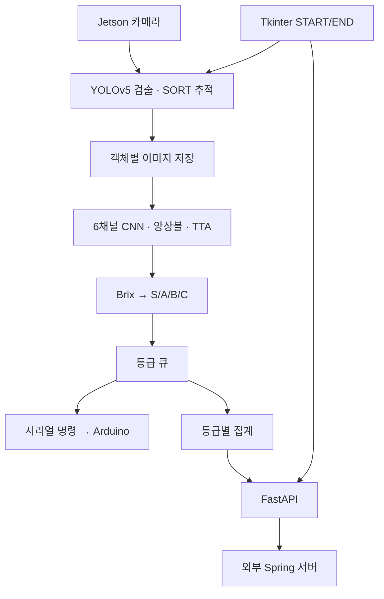

# SugAI
### 영상 인식과 당도 예측을 연결한 과일 자동 선별 시스템

**🏆 한이음 동상 수상**

카메라 영상에서 과일을 검출하고, 과일 이미지의 당도(Brix)를 추정해 S/A/B/C 등급으로 분류하는 프로젝트입니다. 예측 결과를 Arduino 기반 선별 장치에 전달하고, 등급별 검사 집계를 외부 Spring 서버로 전송하는 흐름을 구성했습니다.

이 저장소에는 **영상 처리·당도 추론·Jetson 제어·FastAPI 연동 코드**가 포함되어 있습니다. 외부 Spring 서버와 Arduino 펌웨어는 별도로 준비해야 합니다.

## 주요 기능

| 기능 | 구현 내용 |
|---|---|
| 객체 검출·추적 | YOLOv5와 SORT로 과일을 검출하고 추적 ID를 부여 |
| 객체별 이미지 저장 | 추적 ID를 기준으로 같은 객체의 반복 저장을 억제하고 검출 영역을 crop |
| 당도 예측 | RGB+HSV 6채널 CNN과 5개 fold 가중치의 앙상블 사용 |
| 추론 결과 집계 | 좌우 반전 TTA와 예측 분산에 따른 평균·절사 평균·중앙값 선택 |
| 등급 판정 | 예측 당도를 S/A/B/C 등급으로 변환 |
| 장치 제어 | 큐에 저장된 등급을 시리얼 통신으로 Arduino에 전달 |
| 검사 결과 전송 | FastAPI에서 외부 Spring 서버에 로그인한 뒤 등급별 집계 전송 |
| 제어 화면 | Tkinter START/END 버튼으로 검사 시작과 종료 |

## 시스템 구성



큐 워커는 **7초 간격으로 한 항목씩** 처리합니다(`config.QUEUE_POLL_INTERVAL`). 시리얼 명령 전송과 등급 카운트 증가는 워커의 handler에서 수행합니다.

## 당도 예측 모델

### 입력과 전처리

1. 이미지를 읽어 RGB로 변환합니다.
2. 이미지를 128 × 128 크기로 조정합니다.
3. RGB와 HSV를 각각 정규화한 뒤 6채널 입력으로 결합합니다.

### 모델 구조

`brix_model/predictor.py`의 `BrixRegression6CH_Deep`을 사용합니다.

- 4개 convolution block: 6 → 32 → 64 → 128 → 256채널
- 각 block: Conv2d·BatchNorm·LeakyReLU·MaxPool·Dropout
- Adaptive Average Pooling 이후 회귀 head에서 당도 값 하나 출력
- `best_model(Regressor)_fold1.pth`부터 `fold5.pth`까지 5개 가중치 사용

각 모델은 원본 이미지와 좌우 반전 이미지의 예측을 평균합니다. 모델별 예측의 표준편차에 따라 최종 집계 방법을 선택합니다.

| 모델 간 예측 표준편차 | 집계 방법 |
|---|---|
| 1.0 미만 | 평균 |
| 1.0 이상, 2.0 미만 | 양 끝 20%를 제외한 절사 평균 |
| 2.0 이상 | 중앙값 |

최종 예측값은 코드에서 **3.0~12.5 Brix**로 제한합니다. 이 범위는 구현상의 설정이며, 실제 당도 분포나 성능을 입증하는 수치는 아닙니다.

### 등급 기준

현재 코드의 프로젝트 내부 기준입니다.

| 등급 | 예측 Brix |
|---|---|
| C | 5.56 미만 |
| B | 5.56 이상, 6.97 미만 |
| A | 6.97 이상, 9.23 미만 |
| S | 9.23 이상 |

## 검사 실행 흐름

1. **START**: 로컬 FastAPI 서버와 시리얼 포트를 열고, 큐 워커와 `detect_fruit.py`를 실행합니다.
2. **검출·추론**: 과일 crop을 저장하고 `predict_brix()`로 당도를 추론한 뒤 `brix_to_grade()`로 등급을 계산합니다.
3. **결과 전달**: 검출 프로세스가 출력한 `GRADE:<등급>:<이미지 경로>`를 제어 프로세스가 읽어 큐에 넣습니다.
4. **선별 명령**: 워커가 등급 문자를 Arduino에 전달하고 등급별 개수를 집계합니다.
5. **END**: 검출과 워커를 종료하고 집계를 FastAPI에 전달합니다. 이후 컨베이어 정지 명령, 카운트 초기화, 시리얼 종료와 캡처 이미지 정리를 수행합니다.

START/END 시 컨베이어에 보내는 문자는 각각 `1`과 `0`입니다. 등급 명령은 `S`, `A`, `B`, `C`를 사용하며, 수신 측 펌웨어가 같은 규약을 처리해야 합니다.

## 기술 스택

| 구분 | 기술 |
|---|---|
| 모델·영상 처리 | Python, PyTorch, YOLOv5, SORT, OpenCV, NumPy |
| 엣지 실행 | NVIDIA Jetson, GStreamer |
| 제어 화면·동시 처리 | Tkinter, threading, queue, subprocess |
| 장치 통신 | pyserial, Arduino |
| API 연동 | FastAPI, Uvicorn, Pydantic, requests |

## 저장소 구조

| 경로 | 역할 |
|---|---|
| `config.py` | 경로·장치·외부 서버 설정을 모은 단일 설정 모듈 |
| `server/app.py` | **제어 화면 진입점** (START/END 버튼) |
| `server/controller.py` | 검사 흐름 제어. 서브프로세스 실행·종료와 검출 이벤트 전달 |
| `server/grade_queue.py` | 등급 큐와 선별 명령 워커 |
| `server/serial_link.py` | 아두이노 시리얼 연결과 명령 전송 |
| `server/result_store.py` | 등급별 개수 집계 |
| `server/api.py` | 검사 결과를 외부 Spring 서버로 중계하는 로컬 FastAPI |
| `server/_bootstrap.py` | `config.py`를 import할 수 있도록 `sys.path`를 잡아 주는 보조 모듈 |
| `yolov5/detect_fruit.py` | 검출·추적·crop 저장·당도 모델 호출 |
| `brix_model/predictor.py` | 6채널 CNN, 앙상블 로딩, 당도·등급 추론 |
| `brix_model/predict_images.py` | 이미지 폴더를 순회하는 추론 실행 스크립트 |
| `brix_model/*fold*.pth` | 당도 회귀 모델 가중치 |
| `labels.csv` | 이미지 파일명과 Brix 라벨 |
| `train_images/`, `test_images/` | 저장소에 포함된 이미지 폴더 |
| `legacy/` | 실행 경로에서 쓰이지 않는 구버전·보조 코드 ([legacy/README.md](legacy/README.md)) |

`yolov5/`의 나머지 파일은 업스트림 YOLOv5 코드이며 그대로 사용합니다.

### 모듈 의존 관계

```
server/app.py
  └─ server/controller.py
       ├─ server/serial_link.py ─┐
       ├─ server/result_store.py ┼─ config.py
       ├─ server/grade_queue.py ─┘
       ├─ server/api.py              (uvicorn 서브프로세스로 실행)
       └─ yolov5/detect_fruit.py     (서브프로세스로 실행)
            └─ brix_model/predictor.py
```

검출 스크립트는 별도 프로세스로 돌면서 표준출력에 `GRADE:<등급>:<경로>`를 찍고,
`controller.py`의 리더 스레드가 그 줄을 읽어 등급 큐에 넣습니다. YOLO와 PyTorch
초기화가 Tkinter 메인 루프를 멈추게 하므로 프로세스를 분리했습니다.

## 실행 준비

경로는 `config.py`가 저장소 위치에서 계산하므로 따로 맞출 필요가 없습니다. 다만 아래 환경은 직접 준비해야 합니다.

- Jetson/JetPack과 호환되는 PyTorch·torchvision 및 YOLOv5 의존성
- GStreamer를 지원하는 OpenCV와 Jetson 카메라
- Tkinter를 사용할 수 있는 디스플레이 환경
- 연결된 Arduino와 해당 시리얼 포트 접근 권한
- **별도로 준비한 검출 가중치 `yolov5/best.pt`**: 저장소에 포함되어 있지 않습니다.
- 외부 Spring 서버의 로그인·검사 API와 연동 계정

### 1. 저장소 준비

경로는 `config.py`가 자기 위치에서 계산하므로 **아무 곳에나 clone해도 됩니다.**

```bash
git clone https://github.com/Dongju-00/SugAI.git
cd SugAI
```

### 2. 설정

모든 설정은 [`config.py`](config.py) 한 곳에 모여 있고, 대부분 `SUGAI_` 환경변수로
덮어쓸 수 있습니다. 소스를 고치지 않고 장비마다 다른 값을 줄 수 있습니다.

| 환경변수 | 기본값 | 설명 |
|---|---|---|
| `SUGAI_SERIAL_PORT` | `/dev/ttyACM0` | 아두이노 시리얼 포트 |
| `SUGAI_CAMERA_SOURCE` | Jetson CSI 파이프라인 | GStreamer 파이프라인, 카메라 번호, 영상 경로 |
| `SUGAI_DETECT_WEIGHTS` | `yolov5/best.pt` | 검출 가중치 경로 |
| `SUGAI_CAPTURES_DIR` | `<저장소>/captures` | crop 이미지 저장 폴더 |
| `SUGAI_DETECT_VIEW_IMG` | `1` | 디스플레이가 없으면 `0` |
| `SUGAI_DETECT_HALF` | `1` | GPU가 없으면 `0` |
| `SUGAI_QUEUE_POLL_INTERVAL` | `7.0` | 등급 큐 처리 간격(초) |
| `SUGAI_FRUIT_TYPE_ID` | `1` | Spring의 과일 종류 ID |
| `SUGAI_SPRING_BASE_URL` | `http://13.125.20.176:8080` | 외부 Spring 서버 |
| `SUGAI_SPRING_USERNAME` / `SUGAI_SPRING_PASSWORD` | `test1` / `1234` | 연동 계정 |

```bash
export SUGAI_SERIAL_PORT=/dev/ttyUSB0
export SUGAI_SPRING_PASSWORD='...'
```

연동 계정의 기본값은 코드에 남아 있는 개발용 값입니다. **운영 환경에서는 반드시
환경변수로 덮어쓰세요.**

### 3. 제어 화면 실행

```bash
cd server
python app.py
```

제어 화면에서 START/END로 검사 흐름을 실행합니다. 종료 동작이 캡처 이미지를 정리하므로,
분석용 이미지는 END 전에 별도로 보관해야 합니다.

### 4. 당도 모델만 실행

```bash
cd brix_model
python predict_images.py                 # config.CAPTURES_DIR 를 봅니다
python predict_images.py ../test_images   # 폴더를 직접 지정
```

이미지별 추론을 확인하는 도구이며, MAE·RMSE를 계산하는 성능 평가기는 아닙니다.

### 5. 검출만 확인

당도 추론과 crop 저장 없이 검출·추적만 눈으로 보려면:

```bash
cd yolov5
python detect_fruit.py --weights best.pt --source 0 --view-img --no-save
```

## 검사 결과 API

### POST /send-inspection

`server/api.py`가 제공하는 로컬 API입니다.

```json
{
  "fruitTypeId": 1,
  "counts": {
    "S": 10,
    "A": 8,
    "B": 5,
    "C": 2
  }
}
```

API는 외부 Spring 로그인 응답의 `data.accessToken`을 읽고, Bearer 토큰으로 검사 결과를 전송합니다.

전송이 실패해도 HTTP 200으로 응답하고 본문의 `ok` 필드로 성공 여부를 알립니다. 제어 코드가
END 처리를 끝까지 진행할 수 있어야 하기 때문입니다.

```json
{ "ok": true, "message": "등급 정보 전송 성공", "server_response": { } }
```

## 현재 한계와 개선 방향

- **모델 평가**: MAE·RMSE·등급별 혼동행렬과 Jetson 추론 지연을 별도 측정해야 합니다. 현재 문서에는 검증되지 않은 성능 수치를 기재하지 않았습니다.
- **추적 범위**: 중복 저장 억제는 SORT 추적 ID 기준입니다. 추적 ID가 바뀌면 동일 과일이 다시 저장될 수 있습니다.
- **장치 처리**: 현재 시리얼 전송 실패 후에도 카운트가 증가할 수 있으므로, 실제 장치 응답에 따른 집계·재시도 정책이 필요합니다.
- **종료·재시작**: END 시 큐에 남은 항목은 처리되지 않고 버려지며, 같은 창에서 다시 START를 눌러도 큐 워커가 재시작되지 않습니다(스레드를 다시 시작할 수 없음). 다음 검사는 제어 화면을 다시 띄워서 시작해야 합니다.
- **데이터 재현성**: 이미지·라벨 정합성과 과일 단위 학습/검증 분할, 학습 설정을 문서화해야 합니다.
- **의존성 명세**: Jetson/JetPack에 맞는 PyTorch·torchvision·OpenCV 버전을 명시한 설치 문서가 필요합니다.
- **계정 관리**: 연동 계정 기본값이 아직 코드에 남아 있습니다. `.env` 파일이나 비밀 관리 도구로 옮겨야 합니다.

## 오픈소스

객체 검출에는 저장소에 포함된 YOLOv5 코드를 사용합니다. 해당 코드의 사용 조건은 [yolov5/LICENSE](yolov5/LICENSE)를 참고하세요.
