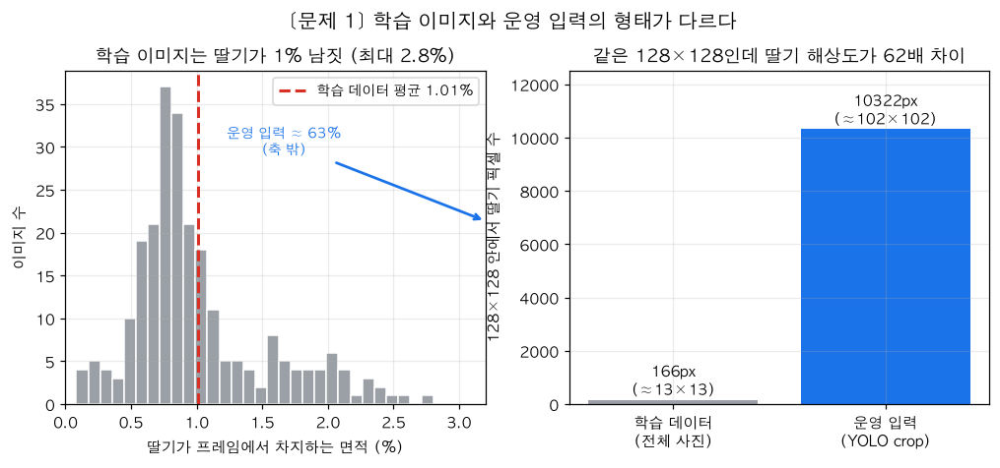
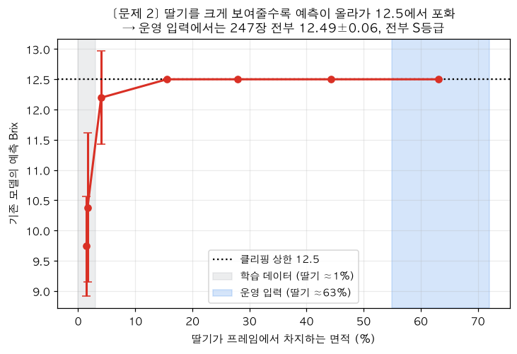
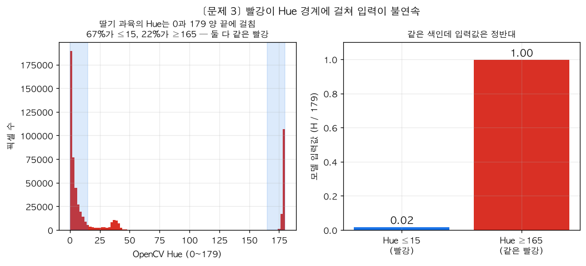
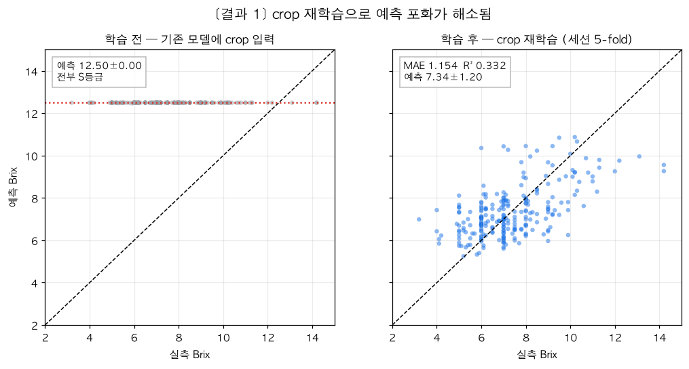
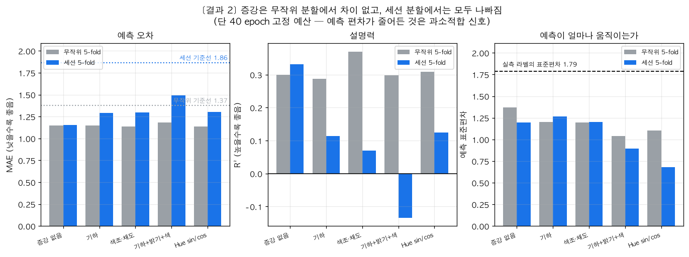
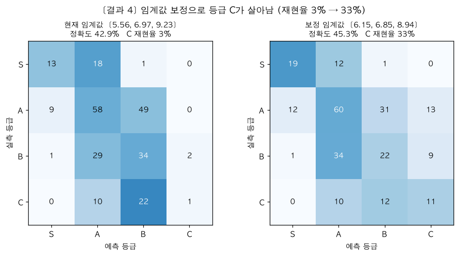
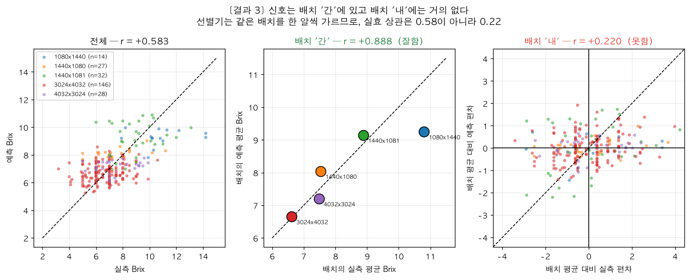

# 당도 예측 모델 개선 보고서

*작성 2026-10-22 · 대상 브랜치 `refactor/structure-and-training`*

사진으로 딸기 당도(Brix)를 추정하는 모델을 점검하고 다시 학습한 기록입니다.
**측정한 것만 적었고, 재현 방법을 함께 남겼습니다.**

---

## 요약

| | 내용 |
|---|---|
| **가장 큰 문제** | 배포된 파이프라인이 모든 딸기를 12.50 Brix / S등급으로 출력하고 있었음 |
| **원인** | 학습 이미지(딸기가 프레임의 1%)와 운영 입력(63%)의 형태 불일치 |
| **조치** | 학습 데이터를 운영 입력과 같은 모양(딸기 crop)으로 다시 만들어 재학습 |
| **결과** | 포화 해소. held-out MAE 1.154, 기준선 대비 38% 개선. 기준선을 유의하게 이김 |
| **남은 한계** | 신호가 **배치 간**에만 있고 **배치 내** 판별력이 약함 (r = 0.22) |

선별기는 같은 배치의 딸기를 한 알씩 가릅니다. 그 조건에서의 실효 상관이 0.22라는 것이
이 프로젝트의 **진짜 병목**입니다. 모델 구조나 증강으로는 풀리지 않고 데이터 수집 방식을
바꿔야 합니다.

---

## 1. 문제

### 1-1. 배포 파이프라인이 상수를 출력하고 있었다

`detect_fruit.py`가 YOLO로 잘라 넘기는 crop을 기존 모델에 넣으면:

```
247장 전부  →  12.49 ± 0.06 Brix   (클리핑 상한 12.5)
등급 분포   →  S 247 / A 0 / B 0 / C 0
```

등급을 매기는 것이 아니라 **상수를 뱉고 있었습니다.** 기존 평가에서 이게 보이지 않았던
이유는, 평가를 전체 사진으로 했기 때문입니다. 운영 입력 형태로는 아무도 재보지 않았습니다.

### 1-2. 원인 — 학습 이미지와 운영 입력의 형태가 다르다



| | 딸기가 차지하는 면적 | 128×128 안에서의 크기 |
|---|---|---|
| 학습 이미지 (흰 종이 위 휴대폰 사진) | **1.01%** | 약 13×13 픽셀 |
| 운영 입력 (YOLO 박스 crop) | **약 63%** | 약 102×102 픽셀 |

딸기 면적 비율을 바꿔가며 모델 반응을 쓸어보면 원인이 분명해집니다.



면적비 1.5% → 63%로 갈수록 예측이 단조 증가하다가 12.5에서 포화합니다. 모델이 색이 아니라
**면적**을 상당 부분 학습했습니다 (학습 데이터에서 면적비 vs 예측 r = +0.477,
면적비 vs 실측 Brix r = +0.366).

### 1-3. 측정 수단 자체가 없었다

- `test_images/`는 `train_images/`의 **바이트 단위 동일한 부분집합**(061~073.jpg)이었습니다.
  held-out 검증셋이 아예 없었습니다.
- **학습 파이프라인이 저장소에 빠져 있었습니다.** 모델을 학습시킨 흐름 자체는 이전부터
  있었고 `.pth` 5개가 그 결과물입니다. 다만 그 코드가 커밋된 적이 없어(`git log --all`로 확인)
  학습 설정(fold 분할, epoch, 증강, 손실)이 어디에도 남아 있지 않고, 재학습할 방법도
  없었습니다.

### 1-4. Hue 표현이 빨강에서 끊긴다



OpenCV의 Hue는 0~179 **원형**이라 빨강이 양 끝에 걸칩니다. 딸기 과육 픽셀의 67%가 Hue ≤15,
22%가 Hue ≥165 — 같은 빨강인데 모델 입력 `H/179`에서는 **0.02와 1.00**으로 정반대가 됩니다.

---

## 2. 시도

### 2-1. 쓰던 학습 파이프라인을 저장소에 들이기

저장소에 빠져 있던 것을 채워 넣는 작업입니다. 모델 구조와 전처리는 기존 흐름을 그대로
따르되, 학습·평가 과정을 코드로 남겨 다시 돌릴 수 있게 했습니다.

| 파일 | 역할 |
|---|---|
| `brix_model/make_crops.py` | 원본 사진 → 딸기 박스 crop 데이터셋 (HSV 빨강 마스크, 247/247 성공) |
| `brix_model/dataset.py` | 전처리·증강·분할. 전처리는 여기 한 곳에만 둠 |
| `brix_model/train.py` | 학습·조기종료·held-out 평가 |
| `brix_model/experiments.py` | 증강 조합 비교 |
| `brix_model/crossval.py` | k-fold 교차검증 (무작위 / 세션 그룹) |
| `brix_model/grades.py` | 등급 성능 분석·임계값 재보정 |
| `brix_model/plots.py` | 결과 시각화 |

**전처리를 `dataset.py` 한 곳에 모은 것이 핵심입니다.** 학습과 추론의 전처리가 갈라지는 것이
이 프로젝트가 망가진 원인이었습니다.

### 2-2. 학습 방법

```
모델      BrixRegression6CH_Deep (기존과 동일, 파라미터 1,208,065개)
입력      딸기 crop → 128×128 → RGB 3채널 + HSV 3채널 = 6채널
손실      Huber (SmoothL1, beta=1.0)
최적화    Adam, lr 1e-3, weight decay 1e-4, CosineAnnealing
배치      32
예산      40 epoch 고정 (조기 종료 없음)
```

**조기 종료를 끈 이유**가 중요합니다. 처음에는 검증 MAE 기준 조기 종료를 썼는데,
best epoch가 4~54로 들쭉날쭉했습니다. 검증셋이 48장뿐이라 "언제 멈출지" 자체가 운에
좌우됐고, **증강은 수렴이 느린데 짧은 patience가 먼저 끊어** 구조적으로 불리했습니다.
실제로 기하 증강 순위가 조기 종료에서는 최하위, 고정 예산에서는 중위권으로 뒤집혔습니다.

### 2-3. 두 가지 분할로 평가

| 분할 | 테스트 구성 | 재는 것 |
|---|---|---|
| **무작위 5-fold** | 모든 세션이 섞임 | 같은 촬영 조건의 새 딸기 |
| **세션 5-fold** | 한 세션(=촬영 회차) 통째로 | **처음 보는 촬영 조건**의 새 딸기 |

두 분할을 모두 쓴 이유는, 이 데이터에서 **촬영 세션이 당도와 엮여 있기** 때문입니다.
이미지 내용을 전혀 보지 않고 원본 해상도(=세션)만으로 Brix를 예측하면 MAE 1.095 / R² 0.408이
나옵니다. 무작위 분할만 쓰면 모델이 딸기가 아니라 촬영 조건을 외워도 점수가 나옵니다.

두 분할 모두 **247장 전부가 정확히 한 번씩 테스트**됩니다 (누수 검증 완료).

---

## 3. 결과

### 3-1. 학습 전 / 후



| | 학습 전 (기존 모델 + crop 입력) | 학습 후 (crop 재학습) |
|---|---|---|
| 예측 | **12.50 ± 0.00** (완전 포화) | **7.34 ± 1.20** |
| 등급 분포 | 전부 S | 정상 |
| MAE | 5.183 | **1.154** |
| R² | −8.32 | **+0.332** |

**포화 문제가 해소됐습니다.** 그리고 모델은 기준선을 유의하게 이깁니다.

```
모델 vs 오라클 기준선(테스트 평균을 아는 가상의 모델)
  MAE 차이 −0.225   95% CI [−0.344, −0.104]   → 모델이 유의하게 좋음
```

오라클 기준선은 테스트 셋의 참 평균을 공짜로 아는, 실제로는 불가능한 상대입니다.
그것조차 이긴다는 것은 **사진에서 당도 신호를 실제로 읽고 있다**는 뜻입니다.

### 3-2. 촬영 조건을 외운 것이 아니다

세션을 통째로 빼도 성능이 유지됩니다.

| 분할 | MAE | R² | 기준선 | 기준선 대비 |
|---|---|---|---|---|
| 무작위 5-fold | 1.150 | 0.300 | 1.375 | 16.3% |
| **세션 5-fold** | **1.154** | **0.332** | 1.864 | **38.1%** |

처음 세운 가설("모델이 종이·조명으로 세션을 알아보고 평균 당도를 외운다")은 **틀렸습니다.**
그랬다면 세션을 빼는 순간 무너졌어야 합니다.

### 3-3. 증강 비교



| 조합 | 무작위 MAE / R² | 세션 MAE / R² | R² 손실 |
|---|---|---|---|
| **증강 없음** | 1.150 / 0.300 | **1.154 / 0.332** | **+0.032** |
| 기하 (뒤집기·회전) | 1.147 / 0.288 | 1.289 / 0.114 | −0.174 |
| 색조·채도 (±6°/±20%) | 1.135 / 0.370 | 1.299 / 0.070 | −0.300 |
| 기하+밝기 · Hue sin/cos | 1.137 / 0.310 | 1.302 / 0.125 | −0.184 |
| 기하+밝기+색 | 1.182 / 0.299 | 1.492 / **−0.134** | −0.433 |

페어드 부트스트랩(동일 247장, 10,000회):

| 분할 | 판정 |
|---|---|
| 무작위 5-fold | **5개 조합 전부 차이 없음** (CI가 모두 0을 포함) |
| 세션 5-fold | **증강을 건 4개 모두 유의하게 나쁨** (CI가 모두 0 초과) |

**그래서 "증강 없음"을 선택했습니다.** 어느 분할에서도 증강이 이득을 주지 못했고,
처음 보는 촬영 조건에서는 오히려 해로웠습니다.

> **단서를 분명히 둡니다.** "증강이 해롭다"고 단정할 수 없습니다. 40 epoch 고정 예산에서
> 증강을 걸면 수렴이 느려 **과소적합**한 것일 수 있습니다. 예측 표준편차가 그 증거입니다 —
> 증강 없음 1.20 → 기하+밝기+색 0.89 → Hue sin/cos 0.68로, 증강이 무거울수록 예측이
> 평균 쪽으로 움츠립니다. 과적합을 막은 것이 아니라 아직 못 배운 모양입니다.
> **긴 예산(100~150 epoch)에서의 재확인이 필요합니다.**

학습과 무관한 독립 측정도 같은 방향을 가리킵니다. 같은 딸기를 증강한 뒤 "색 통계 ↔ Brix"
상관이 얼마나 남는지 재면:

| 증강 | 색조 신호 유지율 | 채도 | 명도 |
|---|---|---|---|
| 기하 | 99% | 98% | 99% |
| 밝기 ±20% | 96% | 94% | 87% |
| **색조±6°·채도±20%** | **41%** | 58% | 100% |

색조 증강이 만드는 **같은 딸기 안의** 색조 흔들림(±51.9)이 딸기 **사이의** 실제 차이(±37.98)보다
큽니다. 구분해야 할 것을 뭉개는 셈입니다. Hue 끊김(1-4) 때문에 ±6°만 흔들어도 입력값이
0↔1로 점프하는 것이 원인입니다.

### 3-4. 등급 성능



현재 운영 임계값 `[5.56, 6.97, 9.23]`에서는 **등급 C가 거의 나오지 않습니다.**
재학습 전에는 재현율 0%(예측 최소값 5.606 > 임계값 5.56), 재학습 후에도 3%입니다.
선별기가 C 칸으로 사실상 동작하지 않습니다.

예측 분포에 맞춰 임계값을 다시 잡으면:

| | 현재 `[5.56, 6.97, 9.23]` | 보정 `[6.15, 6.85, 8.94]` |
|---|---|---|
| 등급 정확도 | 42.9% | **45.3%** |
| 재현율 S / A / B / C | 41 / 50 / 52 / **3**% | 59 / 52 / 33 / **33**% |

**재학습만으로는 C 문제가 풀리지 않습니다.** 임계값 보정이 함께 필요합니다.
단 위 보정값은 테스트 셋에서 뽑아 낙관적이므로, 실제로는 학습/검증 예측으로 구해야 합니다.

### 3-5. 가장 중요한 발견 — 신호는 배치 '간'에 있지 '내'에 없다



세션 5-fold 예측을 세션 간/내로 분해하면:

| | 상관 r | 의미 |
|---|---|---|
| 전체 247장 | +0.583 | 겉보기 성능 |
| **배치 '간'** (세션 평균 5점) | **+0.888** | 배치의 전반적 당도 수준은 잘 맞힘 |
| **배치 '내'** (장수 가중 평균) | **+0.228** | 같은 배치 안에서 딸기를 거의 구분 못 함 |

세션별 R²는 **다섯 개 모두 음수**입니다 (−0.012 ~ −0.794). 한 배치 안에서는 그 배치의
평균을 답하는 것보다 못합니다.

이것은 세션을 외운 것이 **아닙니다.** 세션을 통째로 뺐는데도 그 세션의 당도 수준을 맞혔으므로
(배치 간 r = 0.888), 색에서 배치 수준의 숙도를 실제로 읽고 있습니다. 다만 개별 딸기를
가르는 힘이 약합니다.

**제품 관점에서 이것이 핵심 한계입니다.** 선별기는 컨베이어에 올라오는 딸기를 한 알씩
등급 매기고, 그 딸기들은 보통 같은 배치입니다. 그 조건에서 실효 상관은 0.58이 아니라
**0.22**입니다. 겉보기 MAE/R²만 보면 이 한계가 보이지 않습니다.

---

## 4. 선택과 근거

| 선택 | 이유 |
|---|---|
| **딸기 crop으로 학습** | 운영 입력과 형태를 맞춤. 포화 해소의 직접 원인 |
| **증강 없음** | 두 분할 어디서도 이득 없음. 세션 분할에서는 유의하게 해로움 |
| **HSV 6채널 유지** | Hue sin/cos가 릿지에서는 이득(R² 0.236→0.346)이었으나 CNN에서는 유의하지 않음 |
| **40 epoch 고정** | 조기 종료는 검증 48장에서 운에 좌우되고 증강에 불리함 |
| **세션 5-fold를 주 지표로** | 무작위 분할은 세션 누수를 막지 못함 |
| **임계값 보정 필요** | 재학습만으로 등급 C 재현율이 3%에 그침 |

---

## 5. 앞으로의 과제

### 우선순위 1 — 배치 내 판별력 (데이터 문제)

지금 신호는 거의 배치 간에만 있습니다(배치 내 r = 0.22). 선별기는 같은 배치를 한 알씩
가르므로, 이것을 못 올리면 **모델을 아무리 손봐도 제품이 동작하지 않습니다.**

필요한 것은 **같은 날·같은 조명에서 당도가 서로 다른 딸기**를 모아 찍은 데이터입니다.
현재 데이터는 배치마다 당도가 몰려 있어(세션별 평균 6.62 ~ 10.80) 이 능력을 학습시킬
수가 없습니다.

### 우선순위 2 — 긴 예산에서 증강 재확인

40 epoch에서는 증강이 과소적합합니다. 100~150 epoch에서 다시 재야 "증강이 해로운가"에
답할 수 있습니다.

### 우선순위 3 — 임계값 보정을 학습/검증 기준으로

`grades.py`가 준비되어 있습니다. 현재 보고한 보정값은 테스트 셋에서 뽑아 낙관적입니다.

### 그 밖에

- **모델 축소** — 파라미터 1,208,065개 / 학습 이미지 149~186장. 이미지당 8,000 파라미터로
  용량이 심하게 과합니다.
- **라벨 해상도** — 247장에 고유 Brix 값이 61개뿐이고 정수에 몰려 있습니다.
- **회귀 대신 4-클래스 분류** — 어차피 필요한 것은 S/A/B/C 네 칸입니다. 분류로 가면
  클래스 불균형을 손실 함수로 다룰 수 있고 C 문제를 직접 제어할 수 있습니다.

### 기대치

사진으로 당도를 맞히는 과제 자체가 어렵습니다. 색은 숙도와, 숙도는 당도와 연관되지만
둘 다 느슨합니다. 측정된 상한이 r ≈ 0.58, MAE ≈ 1.15입니다. **배치 내 MAE 1.0 아래**를
현실적 목표로 잡는 것이 좋습니다.

---

## 6. 트러블슈팅 기록

작업하면서 실제로 막혔거나, 하마터면 잘못된 결론을 낼 뻔한 지점들입니다.

### 6-1. 모델 계층 이름을 바꿨더니 가중치가 조용히 안 실림

가독성을 위해 `self.fc`를 `self.head`로 바꿨습니다. 그런데 저장된 `.pth`의 키가
`fc.1.*`, `fc.4.*`였습니다. 기존 코드가 `load_state_dict(state, strict=False)`를 쓰고 있어
**에러 없이 회귀 head만 무작위 초기값으로 로드**될 상황이었습니다.

```python
missing, unexpected = model.load_state_dict(state, strict=False)
if missing or unexpected:
    raise RuntimeError("가중치 구조가 모델과 다릅니다: ...")
```

이름을 되돌리고, 키 불일치를 조용히 넘기지 않도록 예외를 던지게 바꿨습니다.
**`strict=False`는 "유연함"이 아니라 "조용한 실패"입니다.**

### 6-2. 프로세스 경계에서 플래그 이름이 어긋남

`controller.py`가 `--save-crop-once`를 넘기는데 리팩터링 중 검출 스크립트에서 그 플래그를
없앴습니다. 단위 테스트로는 안 잡히는 종류의 버그입니다.

해결: 제어 코드가 만드는 argv를 실제 검출 스크립트의 파서에 먹여보는 테스트를 추가했습니다.

```python
cmd = capture_popen_argv(controller.start_detect)
opt = detect_fruit.parse_opt(cmd[2:])   # argparse가 거부하면 실패
```

### 6-3. 조기 종료가 증강을 체계적으로 불리하게 만듦

1차 실험에서 기하 증강이 최하위였는데, best epoch가 **4**였습니다. patience 15라
19 epoch 만에 끝난 것입니다. 증강은 매 epoch 데이터가 달라져 수렴이 느린데, 짧은 patience가
먼저 끊었습니다.

고정 예산으로 바꾸자 같은 조합이 중위권으로 올라왔습니다. **"증강이 나쁘다"가 아니라
"내 실험 설계가 증강을 불리하게 만들었다"였습니다.** 지표를 믿기 전에 학습 곡선과
best epoch를 보는 습관이 필요합니다.

### 6-4. 임계값 재보정에서 정답지까지 같이 움직임

`grades.py` 초안이 임계값을 바꿀 때 **실측 등급까지 같이 바꾸고** 있었습니다. 실측 분포가
`S32 A116 B66 C33` → `S48 A116 B15 C68`로 변해 비교가 성립하지 않았습니다.

실측 등급 정의는 프로젝트 기준으로 고정하고 예측 쪽만 움직이도록 분리했습니다.

```python
def grade_metrics(pred, true, thresholds, true_thresholds=None):
    """true_thresholds는 정답지 정의. 재보정 시 고정해야 합니다."""
```

### 6-5. 한 시드만 보고 결론을 낼 뻔함

Hue sin/cos가 seed 0에서 MAE 0.997로 1위였습니다. seed 1에서는 1.115로 뒤집혔습니다.
시드 간 변동(0.084)이 조합 간 차이(0.179)와 맞먹는 수준이었습니다.

그래서 k-fold로 옮겼습니다. **247장 전부가 한 번씩 테스트**되므로 같은 계산량으로 훨씬
단단한 추정을 줍니다. 시드를 늘리는 것보다 효율적이었습니다.

### 6-6. 전체 R²는 양수인데 fold별 R²가 전부 음수

이것을 그냥 넘겼다면 "성능 R² 0.33"으로 보고하고 끝났을 겁니다. 분해해 보니 배치 간
신호(r=0.888)와 배치 내 신호(r=0.228)가 완전히 달랐습니다 (3-5절).

**집계 지표가 양수라고 안심하면 안 됩니다.** 그룹 구조가 있는 데이터에서는 그룹 간/내를
분리해 봐야 합니다.

### 6-7. 백그라운드 실행 중 코드를 고쳐도 반영되지 않음

`train.py`에 예측값 저장을 추가했는데, 이미 돌고 있던 실험은 수정 전 모듈을 메모리에
올린 상태였습니다. 그대로 뒀으면 90분을 돌리고도 사후 분석을 못 할 뻔했습니다.
3분 경과 시점이라 재시작했습니다.

### 6-8. 셸 작업 디렉터리가 명령 사이에 유지됨

`cd brix_model` 후 다음 명령에서 `cat > brix_model/dataset.py`를 실행해 파일이 생성되지
않았습니다. 장시간 실험을 `nohup`으로 띄울 때도 같은 이유로 실행 자체가 실패해
15분을 날렸습니다. **백그라운드 작업은 절대 경로로 띄우고, 띄운 직후 로그를 확인해야
합니다.**

---

## 7. 재현 방법

```bash
# 환경 (운영 코드는 Jetson Python 3.6 기준, 학습 실험은 로컬 Python 3.12)
python3 -m venv --system-site-packages .venv
.venv/bin/pip install opencv-python-headless pandas torch matplotlib

cd brix_model
python make_crops.py                      # 딸기 crop 데이터셋 (data/crops/)

python train.py --tag myrun --epochs 40 --patience 0
python crossval.py --split random         # 무작위 5-fold
python crossval.py --split session        # 세션 5-fold (주 지표)
python experiments.py --seeds 0 1         # 증강 조합 비교

python grades.py ../data/runs/crossval_session.json   # 등급 분석·임계값 보정
python plots.py                                        # 그림 생성 (data/figures/)
```

`data/`는 `.gitignore` 대상입니다. 다른 환경에서는 `make_crops.py`부터 다시 돌리세요.
